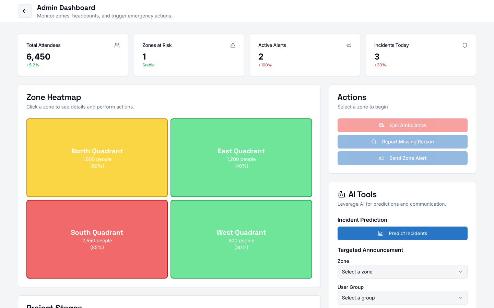
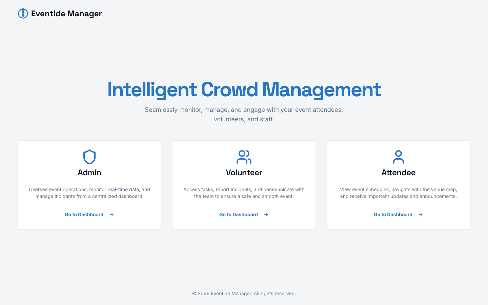
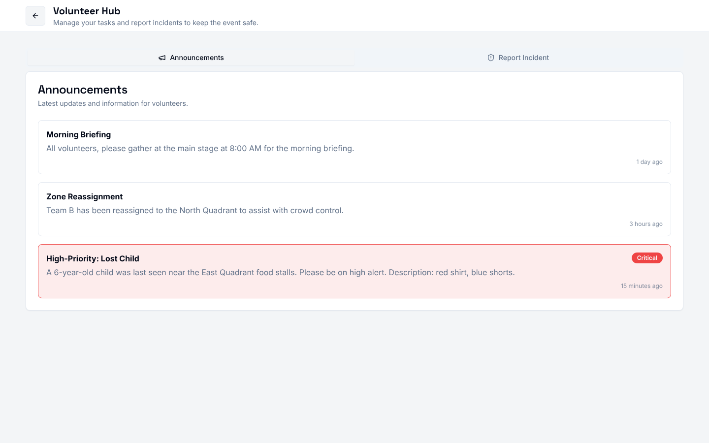
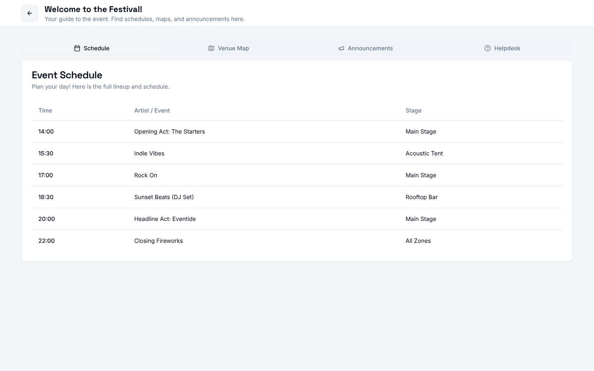

<div align="center">

# 🛡️ Intelligent Crowd Management (Eventide Manager)

### An AI-assisted command centre for large events: live zone heatmaps, incident prediction, and targeted announcements for admins, volunteers and attendees.




</div>

---

## The problem

At festivals, stadium events and religious gatherings, a single overcrowded zone can turn dangerous in minutes. Organisers juggle radios, spreadsheets and guesswork. This app gives every role one screen with the information they need and uses Gemini to flag risk before it becomes an incident.

Built for the **Google Agentic AI Day** hackathon (July 2025).

## Features

**Admin dashboard**
- Live stats: total attendees, zones at risk, active alerts, incidents today
- Colour-coded **zone heatmap** (green, yellow, red by occupancy); click a zone to act on it
- One-click actions: call ambulance, report missing person, send zone alert
- **AI incident prediction**: Gemini reads zone densities plus historical data and returns predicted incidents with type, severity, probability and prevention advice
- **AI targeted announcements**: pick a zone and a user group, and Gemini drafts the message
- Incident timeline and project stages

**Volunteer hub**: announcements feed (with critical alerts highlighted) and an incident report form.

**Attendee hub**: event schedule, venue map, helpdesk and announcements.

## Screenshots

| Landing | Volunteer hub | Attendee hub |
|---|---|---|
|  |  |  |

## How the AI works

The AI features are [Genkit](https://firebase.google.com/docs/genkit) flows in `src/ai/flows/`, each with a typed Zod input and output schema so the model always returns structured data the UI can render:

| Flow | Input | Output |
|---|---|---|
| `incident-prediction.ts` | Zone densities (0 to 1) and historical event data | Predicted incidents: zone, type, severity, probability, recommendations |
| `targeted-announcement-generation.ts` | Zone, user group, situation | A ready-to-send announcement |
| `emergency-dispatch.ts` | Admin action | Calls an external dispatch service |

The model is configured in `src/ai/genkit.ts` (`googleai/gemini-2.0-flash`).

## Run it locally

Requires Node.js 20+ and a Gemini API key from [Google AI Studio](https://aistudio.google.com/apikey).

```bash
npm install
echo "GEMINI_API_KEY=your-key" > .env.local
npm run dev            # http://localhost:9002
npm run genkit:dev     # optional: Genkit developer UI to test the flows
```

The dashboards use sample data, so they render without a key; the AI buttons need one.

## Project structure

```
src/
├── app/
│   ├── page.tsx          # Role picker (Admin, Volunteer, Attendee)
│   ├── admin/            # Command dashboard + server actions
│   ├── volunteer/        # Announcements and incident reporting
│   └── attendee/         # Schedule, map, helpdesk
├── ai/
│   ├── genkit.ts         # Gemini model config
│   └── flows/            # Incident prediction, announcements, dispatch
└── components/           # shadcn/ui components
chatbot.py                # Experimental Streamlit RAG helpdesk bot (LlamaIndex + Gemini)
speech_to_speech/         # Experimental speech-to-text / text-to-speech helpers
```

## Roadmap

- Feed the heatmap from real camera or ticket-scan counts instead of sample data
- Push notifications to attendees in a zone
- Connect the helpdesk to the RAG chatbot

## About me

Built by **Swetha Panthagani**, GenAI engineer. I build AI dashboards, RAG assistants and LLM automations for businesses. [LinkedIn](https://www.linkedin.com/in/swetha-panthagani/)
